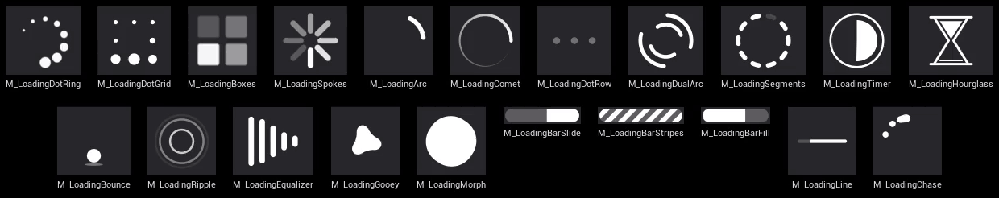
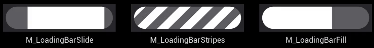

# LoadingFX

[](https://www.unrealengine.com/)
[](LICENSE)
[](#動作環境)

> English version → [README.md](README.md)

LoadingFX は Unreal Engine 5 向けのローディング表示プラグインです。プロシージャルなマテリアル製のスピナーとローディングバー、どこからでも表示・非表示できてゲームスレッドが止まっている間も回り続ける**ローディングアイコン**、進捗付きの軽量な**アセットローダー**を提供します。ローディングアイコンとアセットローダーは独立しているので、片方だけでも、組み合わせても使えます。



## 特徴

- **スピナー 18 種とローディングバー 3 種**。すべてテクスチャを使わないプロシージャル（SDF）マテリアルで、どんな大きさでもにじみません。色や速さは共通のパラメータ（`PrimaryColor`、`Speed`、`Thickness` など）で揃えて変えられます。
- **ローディングアイコン Subsystem**: Blueprint / C++ から `Acquire` / `Release` で表示・非表示。表示要求は参照カウントで管理するので、複数のシステムが同時に要求しても安全です。要求にオーナーを付けておけば、そのオブジェクトが破棄されたときに自動で解除されます。マップ遷移をまたいでも消えません。
- **ブロッキングロード中も回り続ける**: `OpenLevel` や同期ロードでゲームスレッドが止まっている間は、エンジンの MoviePlayer を通してアイコンを描画するので、アニメーションが止まりません。
- **表示までの遅延と最低表示時間**: 短いロードでは何も出さず、遅延を少し越えただけのロードでもチラつきません。
- **UMG ウィジェット**: *LoadingFX Spinner* は好きなマテリアルを自分のウィジェットに置けます。*LoadingFX Progress Bar* はバーのマテリアルを `Progress` の値まで、なめらかに塗ります。
- **アセットローダー**: 進捗とキャンセル付きの非同期ロード、同期ロード、ハンドルとオーナーによる保持。どのロードにも「読み込み中はローディングアイコンを出す」指定ができます。
- **Blueprint のみのプロジェクトでも C++ プロジェクトでも**使えます。

## 動作環境

- Unreal Engine 5.5 – 5.8
- Windows (Win64)

## インストール

**Fab から:** LoadingFX をライブラリに追加し、Epic Games Launcher からエンジンにインストールします。その後プロジェクトの *Edit > Plugins > User Interface > LoadingFX* を有効にしてエディタを再起動してください。

**このリポジトリから:** `Plugins/LoadingFX` をプロジェクトの `Plugins` フォルダにコピーし、同じように有効にします。C++ プロジェクトではプロジェクトと一緒にビルドされます。Blueprint のみのプロジェクトでは、そのエンジンバージョン用のビルド済みバイナリが必要です（Fab のパッケージには同梱されています）。

プラグインはランタイムモジュール 3 つで構成されています。`LoadingFX`（スピナー、ローディングアイコン、UMG ウィジェット）と `LoadingFXLoader`（アセットローダー）は互いに依存せず、`LoadingFXBridge` が両者をつないで「ロード中にアイコンを出す」機能を提供します。

## クイックスタート: ローディングアイコン

1. *Project Settings > Plugins > LoadingFX* を開き、**Loading Icon Material** を選びます（同梱スピナーのどれでも。既定は `M_LoadingDotRing`）。大きさと位置もここで決めます。
2. ロードを始める場所で *LoadingFX Icon Subsystem*（Game Instance Subsystem）の **Acquire Loading Icon** を呼び、返ってきたハンドルを保持します。ロードが終わったら、そのハンドルで **Release Loading Icon** を呼びます。


Blueprint では *Get LoadingFXIconSubsystem* → *Acquire Loading Icon*（`Reason` はログ用のラベル、`Owner` は省略可）→ ハンドルを変数に保存 → あとで *Release Loading Icon*、という流れです。`Owner` を渡すと、そのオブジェクトが破棄されたときにも要求が解除されるので、ウィジェットやアクターが自分の寿命の間だけアイコンを出し、解除を忘れても構いません。

C++ では次のとおりです。

```cpp
#include "LoadingFXIconSubsystem.h"

ULoadingFXIconSubsystem* Icon = GetGameInstance()->GetSubsystem<ULoadingFXIconSubsystem>();
FLoadingFXIconHandle Handle = Icon->Acquire(TEXT("Inventory"), /*Owner*/ this);
// ... あとで
Icon->Release(Handle);
```

アイコンは最初の要求から `IconShowDelay`（既定 0.5 秒）後に現れます。その前に全部の要求を解除すれば、何も表示されません。一度現れたら `IconMinimumDisplayTime`（既定 1 秒）は表示が続きます。`IsIconVisible` と `OnVisibilityChanged` イベントは、実際に画面に出ているかどうかを返します。

**マップ遷移などのブロッキングロード。** マップのロードが始まった時点でアイコンが要求されていれば、プラグインがエンジンのローディング画面（MoviePlayer）を引き継いでそこにアイコンを描くので、ゲームスレッドが止まっている間も回り続けます。ほかに必要な設定はありません。ブロック中の背景は、ほかの MoviePlayer のローディング画面と同じく黒です。遷移がいつ終わったかはプラグインは判断しません。`Open Level` の前に `Acquire` し、移動先のマップで準備ができたら `Release` してください。

> MoviePlayer はエディタと PIE では使えないため、そこではブロッキングロード中にアイコンが止まります。`-game` またはパッケージ版で確認してください。

### 設定

| 設定 | 既定値 | 内容 |
|---|---|---|
| Loading Icon Material | `M_LoadingDotRing` | アイコンが描くマテリアル。この設定のマテリアル（と進捗バーの既定 `M_LoadingBarFill`）は自動でクックされます。ほかの同梱マテリアルは、ウィジェットやアセットから参照されていればクックされます。パスだけで読み込むものは *Directories to Always Cook* に追加してください。 |
| Icon Size | 64 × 64 | Slate 単位の大きさ（ビューポートの DPI でスケール）。不定バーを使うなら 192 × 12 のように横長に。 |
| Icon Horizontal / Vertical Alignment、Icon Padding | 右、下、32 | ビューポート内の位置。 |
| Icon Tint | 白 | マテリアルに乗算されます。アルファでフェードできます。 |
| Icon Show Delay | 0.5 秒 | 最初の要求からアイコンが出るまでの時間。0 なら即座に出ます。 |
| Icon Minimum Display Time | 1 秒 | 一度出たアイコンの最低表示時間。0 なら最後の解除で消えます。 |
| Icon Z-Order | 1000 | ビューポートウィジェットの中での順序。通常の小さい値で追加した HUD より手前です。 |

## スピナーマテリアル

どのスピナーも UI ドメインのマテリアルで、3 通りの使い方ができます。

- **ローディングアイコン**として（Project Settings で選ぶ）
- 自分のウィジェットに **LoadingFX Spinner** ウィジェットを置いて（パレットのカテゴリは *LoadingFX*。マテリアル、色と不透明度、大きさを設定。`Get Dynamic Material` で実行時にパラメータを変えられるインスタンスが取れます）
- 標準の UMG **Image** にブラシとして貼って。ウィジェットに付けた色・不透明度・フェード（`ColorAndOpacity`、`RenderOpacity`、アニメーション）は頂点カラー経由でマテリアルに届きます。

縦横比が変わっても見た目は崩れません（横長・縦長のウィジェットでも形は丸いまま中央に収まります）。ピクセル単位でアンチエイリアスしているので、16 px から全画面までくっきり描けます。

| マテリアル | 見た目 |
|---|---|
| `M_LoadingDotRing` | 輪に並んだ点が尾に向かって小さくなり、時計回りに回る。既定のローディングアイコン。 |
| `M_LoadingDotGrid` | 四角形に並んだ 8 つの点を、膨らみのパルスが時計回りに巡る。 |
| `M_LoadingBoxes` | 角丸の四角 4 つが順に明るくなる。 |
| `M_LoadingSpokes` | おなじみの放射状スピナー。丸い棒の明るさが一周する。 |
| `M_LoadingArc` | 1 本の丸い弧が、伸び縮みしながら回る。 |
| `M_LoadingComet` | 丸い頭と、一周かけて細く薄くなる尾。 |
| `M_LoadingDotRow` | 横に並んだ点が左から順に膨らんで明るくなる。ボタンなど横長で小さい場所向き。 |
| `M_LoadingDualArc` | 外側と内側の輪に 2 対の弧。互いに逆向きに回る。 |
| `M_LoadingSegments` | 輪に並んだ丸いセグメントが 1 つずつ点灯し、同じ順に消える。 |
| `M_LoadingTimer` | 細い輪の中の扇形が時計回りに満ちて、また空になる。 |
| `M_LoadingHourglass` | 砂が上から下へ落ちきると、砂時計がひっくり返る。 |
| `M_LoadingBounce` | ボールが跳ねて着地でつぶれ、影は上昇に合わせて縮む。 |
| `M_LoadingRipple` | 中心から広がる輪が、減速しながら薄れていく。 |
| `M_LoadingEqualizer` | 丸い棒の列が順に伸び縮みする、イコライザー風。 |
| `M_LoadingGooey` | 丸い核から液体のように雫が分かれ、全体が回りながら外へ広がり、また溶け込む。 |
| `M_LoadingMorph` | 角丸の四角が 4 分の 1 回転し、途中で円になり、止まる。 |
| `M_LoadingLine` | 細い不定ライン。薄いトラックの左から棒が伸びて右へ抜ける。スピナーと同じ大きさなので、同じ場所に置けます。 |
| `M_LoadingChase` | 点が輪の上で追いかけ合い、上で固まって一つに溶け、また離れる。 |

### パラメータ

どのマテリアルも、マテリアルインスタンスのエディターで同じようにグループ分けされています。

- **Appearance**: `PrimaryColor`（アルファは不透明度に乗ります）と、付属部分の不透明度（いちばん薄い / 濃い要素の `OpacityMin` / `OpacityMax`、`TrackOpacity`、`RingOpacity`、`ShadowOpacity`）。
- **Shape**: 配置と大きさ。`Count`、`Radius`（輪の半径。1 がウィジェットの短い辺の端）、`Thickness`、`Spacing`、`DotRadius` / `DotRadiusMin` / `DotRadiusMax`、それにマテリアルごとの `Arc`、`Gap`、`Smoothness` など。
- **Motion**: `Speed` は 1 秒あたりの周期（回るものは回転数/秒。正で時計回り、負で逆回転）。ほかに `Stagger`、`PulseWidth`、`TailDelay`、`Easing` などのタイミング。

既定値ではすべてのスピナーが同じ大きさに見えるので、レイアウトを触らずに差し替えられます。色や速さをエディターで変えるなら同梱マテリアルの Material Instance を作り、実行時に変えるならスピナーウィジェットの `Get Dynamic Material` から `Set Scalar Parameter Value` / `Set Vector Parameter Value` を呼んでください。

## ローディングバー



バーは置かれたウィジェットいっぱいに広がります。四辺から同じだけ内側に寄せた横長のピル型なので、320 × 16 のような横長のウィジェットに置いてください（正方形に置くと円になります）。`Thickness` は既定の 1.6 で少し余白が残り、2 でウィジェットを埋めます。`TrackOpacity` はトラックの濃さです。

| マテリアル | 見た目 |
|---|---|
| `M_LoadingBarSlide` | 不定。帯が左から伸び、右へ走って縮んで消える（`TailDelay` で帯の長さ）。 |
| `M_LoadingBarStripes` | 不定。斜めの縞が右へ流れる（`Period`、`Duty`）。 |
| `M_LoadingBarFill` | 進捗あり。`Progress` パラメータ（0〜1）まで塗る。塗った部分を光沢が掃くので、粗い進捗の段差でも動きが見えます（`SheenWidth`、`SheenStrength`。光沢は `PrimaryColor` に色を付けたときに見えます）。 |

不定バーはローディングアイコンにも使えます（*Icon Size* を横長に）。進捗ありのバーは **LoadingFX Progress Bar** ウィジェット用です。既定で `M_LoadingBarFill`（`Progress` パラメータを持つマテリアルなら何でも可）を描き、`Set Progress` で塗りが動きます。増えるときは `SmoothingTime`（0.25 秒）かけてなめらかに、減るときは即座に反映されるので、次のロードのためにリセットしても逆向きに動きません。

アセットローダーとつなぐなら、*Load Assets Async* → *On Progress* → バーの *Set Progress*。配線はこれだけです。

> マップ遷移やブロッキングロードの進捗はエンジンが出しません。ゲームスレッドが止まっている間はウィジェットも更新できません。それらにはスピナーか不定バーを使い、進捗バーは自分で始めたアセットロードに使ってください。

## アセットローダー

`ULoadingFXLoaderSubsystem`（Game Instance Subsystem）は、ソフトオブジェクト参照とソフトクラス参照を非同期または同期で読み込み、解放するまで読み込んだアセットを保持します。

**Blueprint**

- **Load Assets Async**（非同期ノード）: `Assets`（ソフトオブジェクト参照）、`Classes`（ソフトクラス参照）、`Reason`、`Owner`（既定は self）、`Show Loading Icon`。実行ピンは *On Progress*、*On Completed*、*On Canceled* で、どれもハンドル・進捗・読み込んだアセットとクラス（要求した順。失敗したものは null で、ログに警告が 1 つ）を出します。ノードの戻り値はアクションで、`Cancel` と `Is Active` があります。
- **Load Assets Sync**: 同じ入力でブロッキング。ハンドルと、読み込んだアセットとクラスを返します。
- **Release Loaded Assets**（ハンドル）と **Release All Loaded Assets**。読み込み中のロードを解放するとキャンセルになります。問い合わせ用に `Is Handle Active`、`Is Load In Progress`、`Get Load Progress`。

読み込んだアセットは、ハンドルを解放するか `Owner` が破棄されるまでメモリに残ります。ウィジェットやアクターが自分の寿命の間だけ保持する、という使い方ができます。もっと長く保持したいときは Game Instance をオーナーにして、手で解放してください。

要求の **Show Loading Icon** を付けると、そのロードの間ローディングアイコンが要求されます。非同期ロードなら開始から完了（またはキャンセル）まで、同期ロードなら呼び出しの間で、同期の場合は即座に画面が MoviePlayer に切り替わります。フラグなしの同期ロードは、すでに要求されているアイコンを止めないだけです。フラグなしの非同期ロード（バックグラウンドの先読み）がアイコンを出すことはありません。

**C++**

```cpp
#include "LoadingFXLoaderSubsystem.h"

ULoadingFXLoaderSubsystem* Loader = GetGameInstance()->GetSubsystem<ULoadingFXLoaderSubsystem>();
TArray<FSoftObjectPath> Paths = { FSoftObjectPath(TEXT("/Game/UI/T_Portrait.T_Portrait")) };

FLoadingFXLoadHandle Handle = Loader->LoadAssetsAsync(
    Paths, TEXT("Portrait"), /*Owner*/ this, /*bShowLoadingIcon*/ true,
    FLoadingFXLoadCompleted::CreateLambda([](FLoadingFXLoadHandle, const TArray<UObject*>& Loaded)
    {
        // Loaded[i] は Paths[i] に対応。失敗したものは null。
    }),
    FLoadingFXLoadProgressChanged::CreateLambda([](FLoadingFXLoadHandle, float Progress) {}));

// 同期ロード。アイコンが要求されていれば、この間も回り続ける。
TArray<UObject*> Loaded;
Loader->LoadAssetsSync(Paths, TEXT("Portrait"), this, false, Loaded);
```

進捗は「読み込み終わったアセット数 / 要求したアセット数」なので、1 件の要求では 0 から 1 に一気に進みます。コールバックがロードの呼び出しの内側で呼ばれることはありません。

### ブロッキングセクション（C++）

自前の処理でゲームスレッドを止める間もアイコンを回し続けたいときは、その処理をブロッキングセクションで囲みます。

```cpp
#include "LoadingFXIconSubsystem.h"

{
    FLoadingFXBlockingScope Scope(this, TEXT("Building the world"));
    // ... 重い同期処理
}
```

セクションが MoviePlayer を引き継ぐのは、アイコンが要求されていて、ほかのローディング画面が出ていないときだけです。MoviePlayer が使えない環境（エディタ、PIE、`-NoLoadingScreen`）では何もしません。`BeginBlockingSection` / `EndBlockingSection` が手動の形で、入れ子にできます。

## 動かしてみる: サンプル

このリポジトリは開発用プロジェクトです。`LoadingFX_Dev.uproject` を UE 5.5 で開いてください。

**Blueprint サンプル（`Content/Sample`）。** レベル 2 つで、処理はすべて Blueprint です。エディタを開くと `L_LFXSample_Hub` が開きます。*Standalone Game* で再生してください（エディタのビューポート内では MoviePlayer が使えないので、レベルの読み込み中はアイコンが止まります）。

- `L_LFXSample_Hub`: *Loading Icon* ページでは、アイコンを 0.3 秒・0.8 秒・3 秒のあいだ要求し、実際に表示された時刻と消えた時刻をログに出します。表示遅延と最低表示時間の働きが見られます。*Asset Loader* ページでは、同梱のマテリアルを *Load Assets Async* で読み込んで *LoadingFX Progress Bar* に進捗を出します（Cancel と Release 付き）。*Open the Gallery level* はアイコンを要求して Gallery を開きます。要求の Owner は PlayerController なので、遷移で自動的に解除されます。
- `L_LFXSample_Gallery`: 重いレベルを模して、レベルの読み込み中にゲームスレッドを 2 秒止めます（その間もロード画面でアイコンが回ります）。続いて *Show Loading Icon* 付きの *Load Assets Async* で自分のマテリアルを読み込み、21 種すべてを *LoadingFX Spinner* で並べます。1 つ選ぶと、*Get Dynamic Material* で `PrimaryColor` と `Speed` を変えられます。

**コンソールコマンド（プロトタイプ）。** `Source/LoadingFX_Dev/Prototype` の `LFXProto.*` コマンドで、全マテリアルの表示とプラグインの動作確認ができます。エディタの外でプロジェクトを起動し、コマンドを渡します。

```
UnrealEditor.exe <repo>\LoadingFX_Dev.uproject -game -windowed -ResX=1280 -ResY=720 -ExecCmds="LFXProto.Showcase 128"
```

| コマンド | 内容 |
|---|---|
| `LFXProto.Showcase [Size] [ref]` | 同梱マテリアル全部を黒背景に並べる（1 枚 `Size` px。`ref` で大きさの基準線を重ねる）。 |
| `LFXProto.Gallery shot quit` | 全マテリアルを正方形・横長・縦長・色付き・小サイズで描き、`Saved/Screenshots` に保存。 |
| `LFXProto.ProgressBar` | 進捗バー: 実際のアセットロードで動くもの、段階的な更新、スムージング、色付け、不定バー。 |
| `LFXProto.IconTravel` | 4 秒のブロックを模したマップロードを挟んだローディングアイコン。 |
| `LFXProto.Loader quit` | アセットローダーとアイコン連携の 13 ケースをログに出す。 |
| `LoadingFX.Icon.Show` / `Hide` / `Dump`、`LoadingFX.Loader.Dump` | プラグインのコンソールコマンド。どのプロジェクトでも使えます。アイコンを手で出す・消す、要求とロードの一覧を出す。 |

## 制限事項

- **エディタと PIE**: MoviePlayer が使えないため、ブロッキングロード中はローディングアイコンが止まります。ほかの機能は動きます。ブロック中も回る様子は `-game`、*Standalone Game*、パッケージ版で確認してください。
- **マップ遷移の進捗は出ません。** エンジンが報告しないためです。進捗バーはアセットロード専用です。
- ブロック中のアイコンの背景は**黒**です（MoviePlayer の背景）。直前のゲーム画面は残りません。
- ローディングアイコンのマテリアルは**プロジェクトで 1 つ**です。要求ごとの切り替えはありません。
- このバージョンは **Win64** のみです。

## リポジトリ構成

| パス | 内容 |
|---|---|
| `Plugins/LoadingFX/` | プラグイン本体（Fab で配布するもの） |
| `Plugins/DevMaterialTools/` | マテリアルアセットを Python スクリプトから生成するローカルのエディタツール（配布しません） |
| `Plugins/DevSampleTools/` | Blueprint サンプルをテキストから生成するローカルのエディタツール（配布しません） |
| `Source/LoadingFX_Dev/` | サンプルプロジェクトのモジュール。`LFXProto.*` の検証コマンドを含む |
| `Content/Sample/` | Blueprint のサンプルマップとウィジェット |
| `Docs/` | この README の画像 |

## 謝辞

スピナーの形状は [Inigo Quilez](https://iquilezles.org/) 氏が公開している 2D 符号付き距離関数(MIT)をもとにしています。[`sdArc`、`sdPie`、`sdSegment`、`sdEllipse`、`sdRoundBox`](https://iquilezles.org/articles/distfunctions2d/) と、Gooey / Chase の点を溶け合わせる [多項式 smooth minimum](https://iquilezles.org/articles/smin/) です。

## ライセンス

[MIT](LICENSE)
