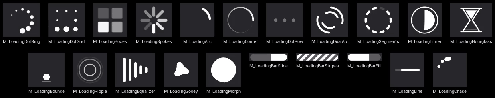
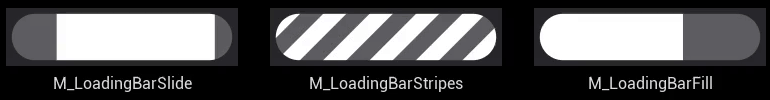

# LoadingFX

[](https://www.unrealengine.com/)
[](LICENSE)
[](#requirements)

> 日本語版はこちら → [README.ja.md](README.ja.md)

LoadingFX is a loading indicator plugin for Unreal Engine 5: a library of procedural, material-based spinners and loading bars, a project-wide **loading icon** you can show and hide from anywhere (and that keeps spinning while the game thread is blocked), and a lightweight **asset loader** with progress. The loading icon and the asset loader are independent. Use either one on its own, or both together.



## Features

- **18 spinners and 3 loading bars**, all procedural (SDF) materials with no textures. They stay sharp at any size, and every one is tinted and timed by the same parameters (`PrimaryColor`, `Speed`, `Thickness`, ...).
- **Loading icon subsystem**: `Acquire` / `Release` from Blueprint or C++. Requests are reference counted, so several systems can ask for the icon at the same time; a request can be tied to an owner object and released automatically when that object is destroyed. The icon survives map travel.
- **Keeps spinning during blocking loads**: while the game thread is blocked (`OpenLevel`, a synchronous load), the icon is rendered through the engine's MoviePlayer, so it keeps animating.
- **Show delay and minimum display time**, so a short load shows nothing at all and a load that just crossed the delay does not flicker.
- **UMG widgets**: *LoadingFX Spinner* draws any of the materials in your own widgets; *LoadingFX Progress Bar* fills a bar material to a `Progress` value, smoothed.
- **Asset loader**: asynchronous loading with progress and cancel, synchronous loading, and handle + owner retention. Any load can show the loading icon while it runs.
- Works in **Blueprint-only and C++ projects**.

## Requirements

- Unreal Engine 5.5 – 5.8
- Windows (Win64)

## Installation

**From Fab:** add LoadingFX to your library and install it to the engine from the Epic Games Launcher. Then enable it in your project under *Edit > Plugins > User Interface > LoadingFX* and restart the editor.

**From this repository:** copy `Plugins/LoadingFX` into your project's `Plugins` folder and enable it the same way. C++ projects rebuild it with the project; Blueprint-only projects need the prebuilt binaries for their engine version (the Fab package ships them).

The plugin has three runtime modules. `LoadingFX` (spinners, the loading icon, the UMG widgets) and `LoadingFXLoader` (the asset loader) do not depend on each other; `LoadingFXBridge` connects them so that loads can show the icon.

## Quick start: the loading icon

1. Open *Project Settings > Plugins > LoadingFX* and pick a **Loading Icon Material** (any bundled spinner; the default is `M_LoadingDotRing`). Set its size and corner there too.
2. Wherever loading starts, call **Acquire Loading Icon** on the *LoadingFX Icon Subsystem* (a Game Instance subsystem) and keep the handle. When the loading is done, call **Release Loading Icon** with that handle.


In Blueprint: *Get LoadingFXIconSubsystem* → *Acquire Loading Icon* (`Reason` is a label for the log, `Owner` is optional) → store the returned handle → later *Release Loading Icon*. If you pass an `Owner`, the request is also released when that object is destroyed, so a widget or actor can acquire the icon for its own lifetime and forget about it.

In C++:

```cpp
#include "LoadingFXIconSubsystem.h"

ULoadingFXIconSubsystem* Icon = GetGameInstance()->GetSubsystem<ULoadingFXIconSubsystem>();
FLoadingFXIconHandle Handle = Icon->Acquire(TEXT("Inventory"), /*Owner*/ this);
// ... later
Icon->Release(Handle);
```

The icon appears after `IconShowDelay` (0.5 s by default): release every request before that and nothing is shown. Once it is on screen it stays for at least `IconMinimumDisplayTime` (1 s). `IsIconVisible` and the `OnVisibilityChanged` event follow what is actually on screen.

**Map travel and other blocking loads.** If the icon is requested when a map load starts, the plugin takes over the engine's loading screen (MoviePlayer) and draws the icon there, so it keeps spinning while the game thread is blocked. Nothing else is needed. The screen behind the icon is black during the block, like any MoviePlayer loading screen. The plugin does not decide when travel is finished: acquire before `Open Level`, release when your destination map is ready.

> MoviePlayer is not available in the editor or in PIE, so there the icon freezes during blocking loads. Check this behavior with `-game` or in a packaged build.

### Settings

| Setting | Default | What it does |
|---|---|---|
| Loading Icon Material | `M_LoadingDotRing` | The material the icon draws. It is cooked with your project automatically (so is `M_LoadingBarFill`, the progress bar's default). Other bundled materials are cooked when a widget or asset references them; a material you only load by path needs a *Directories to Always Cook* entry. |
| Icon Size | 64 × 64 | Size in Slate units (scaled with the viewport DPI). Indeterminate bars want something wide, such as 192 × 12. |
| Icon Horizontal / Vertical Alignment, Icon Padding | right, bottom, 32 | Where the icon sits in the viewport. |
| Icon Tint | white | Multiplied into the material; alpha fades the icon. |
| Icon Show Delay | 0.5 s | Time from the first request until the icon appears. 0 shows it at once. |
| Icon Minimum Display Time | 1 s | Shortest time the icon stays once it appeared. 0 hides it at the last release. |
| Icon Z-Order | 1000 | Among viewport widgets; above HUD widgets added with the usual small values. |

## Spinner materials

Every spinner is a UI-domain material you can use in three ways:

- as the **loading icon** (pick it in Project Settings),
- in your own widgets through the **LoadingFX Spinner** UMG widget (palette category *LoadingFX*: material, color and opacity, size; `Get Dynamic Material` gives you an instance to change parameters at runtime),
- on a plain UMG **Image** (set the material as the brush). Color, opacity and fades applied to the widget (`ColorAndOpacity`, `RenderOpacity`, animations) reach the material through the vertex color.

They keep their look at any aspect ratio (the shape stays round and centered in a wide or tall widget) and are anti-aliased per pixel, so they stay crisp from 16 px to full screen.

| Material | Look |
|---|---|
| `M_LoadingDotRing` | A ring of dots that shrink toward the tail, turning clockwise. The default loading icon. |
| `M_LoadingDotGrid` | Eight dots on a square; a pulse swells them one after another, clockwise. |
| `M_LoadingBoxes` | Four rounded boxes that brighten in turn. |
| `M_LoadingSpokes` | The classic radial spinner: rounded spokes with a fade running around. |
| `M_LoadingArc` | One rounded arc that stretches and shrinks while it turns. |
| `M_LoadingComet` | A round head with a tail that thins and fades over one turn. |
| `M_LoadingDotRow` | A row of dots that swell and brighten left to right. Suits buttons and other wide, small places. |
| `M_LoadingDualArc` | Two pairs of arcs on an outer and an inner ring, turning in opposite directions. |
| `M_LoadingSegments` | A ring of rounded segments that light up one by one, then go out in the same order. |
| `M_LoadingTimer` | A pie inside a thin ring that fills clockwise, then empties. |
| `M_LoadingHourglass` | Sand runs from the top bulb to the bottom one, then the glass turns over. |
| `M_LoadingBounce` | A ball that bounces and flattens on landing, over a shadow that shrinks as it rises. |
| `M_LoadingRipple` | Rings that start at the center, spread out, slow down and fade. |
| `M_LoadingEqualizer` | A row of rounded bars that grow and shrink in turn, like an audio equalizer. |
| `M_LoadingGooey` | Droplets that bud off a round core, drift out while the whole turns, then melt back in. |
| `M_LoadingMorph` | A rounded square that turns a quarter, rounding into a circle halfway, then pauses. |
| `M_LoadingLine` | A thin indeterminate line: a bar grows from the left of a faint track and leaves at the right. Keeps the same size as the spinners, so it fits where they fit. |
| `M_LoadingChase` | Dots that chase each other around a ring, bunching up and melting into one blob at the top, then pulling apart. |

### Parameters

The parameters of every material are grouped the same way in the material instance editor:

- **Appearance**: `PrimaryColor` (alpha scales the opacity) and the opacity of secondary parts (`OpacityMin` / `OpacityMax` for the faintest and brightest element, `TrackOpacity`, `RingOpacity`, `ShadowOpacity`).
- **Shape**: layout and sizes. `Count`, `Radius` (of the ring, in units where 1 is the edge of the widget's shorter side), `Thickness`, `Spacing`, `DotRadius` / `DotRadiusMin` / `DotRadiusMax`, and per-material extras such as `Arc`, `Gap`, `Smoothness`.
- **Motion**: `Speed` in cycles per second (revolutions per second for anything that turns; positive is clockwise, negative reverses), plus timing parameters such as `Stagger`, `PulseWidth`, `TailDelay`, `Easing`.

With their default parameters all spinners are the same visual size, so you can swap one for another without touching the layout. Make a Material Instance of a bundled material to change colors or speeds in the editor, or call `Get Dynamic Material` on the spinner widget and `Set Scalar Parameter Value` / `Set Vector Parameter Value` at runtime.

## Loading bars



The bars span the widget they are drawn in: a horizontal pill inset the same amount on every side, so draw them in something wide such as 320 × 16 (in a square widget they become a circle). `Thickness` 1.6 (default) leaves a small margin; 2 fills the widget. `TrackOpacity` dims the track.

| Material | Look |
|---|---|
| `M_LoadingBarSlide` | Indeterminate. A segment grows from the left, runs right and shrinks away (`TailDelay` sets its length). |
| `M_LoadingBarStripes` | Indeterminate. Diagonal stripes running right (`Period`, `Duty`). |
| `M_LoadingBarFill` | Determinate. Fills to its `Progress` parameter (0 to 1), with a sheen sweeping over the filled part so coarse progress steps still show motion (`SheenWidth`, `SheenStrength`; the sheen is visible on a colored `PrimaryColor`). |

The indeterminate bars work as the loading icon too (set a wide *Icon Size*). The determinate one is for the **LoadingFX Progress Bar** widget: it draws `M_LoadingBarFill` by default (or any material with a `Progress` parameter), and `Set Progress` moves the fill. An increase is smoothed over `SmoothingTime` (0.25 s); a decrease is applied at once, so a bar reset for the next load never runs backwards.

To drive it from the asset loader: *Load Assets Async* → *On Progress* → *Set Progress* on the bar. That is the whole wiring.

> The engine reports no progress for map travel or for blocking loads, and nothing can update a widget while the game thread is blocked. Use a spinner or an indeterminate bar for those; use the progress bar for asset loads you start yourself.

## Asset loader

`ULoadingFXLoaderSubsystem` (a Game Instance subsystem) loads soft object and soft class references, asynchronously or synchronously, and keeps the loaded assets referenced until you release them.

**Blueprint**

- **Load Assets Async** (an async node): `Assets` (soft object references), `Classes` (soft class references), `Reason`, `Owner` (defaults to self), `Show Loading Icon`. Exec outputs *On Progress*, *On Completed* and *On Canceled*, each with the handle, the progress and the loaded assets and classes in the order you requested them (null where a load failed, with one warning in the log). The node returns the action, which has `Cancel` and `Is Active`.
- **Load Assets Sync**: the same inputs, blocking; returns the handle and the loaded assets and classes.
- **Release Loaded Assets** (handle) and **Release All Loaded Assets**. Releasing a load still in flight cancels it. `Is Handle Active`, `Is Load In Progress`, `Get Load Progress` for queries.

Loaded assets stay in memory until the handle is released or the `Owner` is destroyed, so a widget or actor can load for its own lifetime. To keep assets longer, pass the game instance as the owner and release by hand.

**Show Loading Icon** on a request acquires the loading icon for that load: for an async load from start to completion or cancel, for a sync load around the call, where the icon takes over the screen (MoviePlayer) at once. A sync load without the flag only keeps an icon that is already requested animating. Background preloads without the flag never show the icon.

**C++**

```cpp
#include "LoadingFXLoaderSubsystem.h"

ULoadingFXLoaderSubsystem* Loader = GetGameInstance()->GetSubsystem<ULoadingFXLoaderSubsystem>();
TArray<FSoftObjectPath> Paths = { FSoftObjectPath(TEXT("/Game/UI/T_Portrait.T_Portrait")) };

FLoadingFXLoadHandle Handle = Loader->LoadAssetsAsync(
    Paths, TEXT("Portrait"), /*Owner*/ this, /*bShowLoadingIcon*/ true,
    FLoadingFXLoadCompleted::CreateLambda([](FLoadingFXLoadHandle, const TArray<UObject*>& Loaded)
    {
        // Loaded[i] matches Paths[i]; null where the load failed.
    }),
    FLoadingFXLoadProgressChanged::CreateLambda([](FLoadingFXLoadHandle, float Progress) {}));

// A synchronous load: the icon, if requested, keeps animating through it.
TArray<UObject*> Loaded;
Loader->LoadAssetsSync(Paths, TEXT("Portrait"), this, false, Loaded);
```

Progress is finished assets over requested assets, so a one-asset request jumps from 0 to 1. No callback fires inside the load call itself.

### Blocking sections (C++)

If you block the game thread with your own work and want the loading icon to keep animating, wrap the work in a blocking section:

```cpp
#include "LoadingFXIconSubsystem.h"

{
    FLoadingFXBlockingScope Scope(this, TEXT("Building the world"));
    // ... heavy synchronous work
}
```

The section takes over MoviePlayer only while the icon is requested and no other loading screen is up, and does nothing where MoviePlayer is unavailable (editor, PIE, `-NoLoadingScreen`). `BeginBlockingSection` / `EndBlockingSection` are the manual form and nest.

## Try it: the samples

This repository is the development project; open `LoadingFX_Dev.uproject` with UE 5.5.

**Blueprint sample (`Content/Sample`).** `L_LFXSample_Hub` has a widget with travel buttons: each one acquires the loading icon and opens `L_LFXSample_Destination`, which releases it once it is up. Play it with *Standalone Game* (not in the editor viewport, where MoviePlayer is unavailable) to see the icon keep spinning on the loading screen during travel.

**Console commands (prototype).** The `LFXProto.*` commands in `Source/LoadingFX_Dev/Prototype` show every material and exercise the plugin. Run the project outside the editor and pass a command:

```
UnrealEditor.exe <repo>\LoadingFX_Dev.uproject -game -windowed -ResX=1280 -ResY=720 -ExecCmds="LFXProto.Showcase 128"
```

| Command | Shows |
|---|---|
| `LFXProto.Showcase [Size] [ref]` | Every bundled material side by side on black (`Size` px each; `ref` overlays the size reference). |
| `LFXProto.Gallery shot quit` | Every material square, wide, tall, tinted and small, saved to `Saved/Screenshots`. |
| `LFXProto.ProgressBar` | Progress bars: one driven by a real asset load, scripted steps, smoothing, tinting, the indeterminate bars. |
| `LFXProto.IconTravel` | The loading icon through a map load with a simulated 4 s block. |
| `LFXProto.Loader quit` | The asset loader and the icon bridge, 13 logged cases. |
| `LoadingFX.Icon.Show` / `Hide` / `Dump`, `LoadingFX.Loader.Dump` | Plugin console commands, usable in any project: show or hide the icon by hand, list the active requests and loads. |

## Using LoadingFX with AI coding agents

The plugin folder ships an `AGENTS.md` (`Plugins/LoadingFX/AGENTS.md`) written for AI coding agents such as Claude Code, Codex, Cursor, GitHub Copilot and Gemini CLI: the public Blueprint and C++ API, the settings and their defaults, every bundled material with its parameters, the map travel pattern, how to verify the loading screen, and the pitfalls. A `CLAUDE.md` next to it imports the same file for Claude Code.

Agents only read files inside your project, so when the plugin is installed to the engine from Fab (`<EngineDir>/Engine/Plugins/Marketplace/LoadingFX`) they never find it on their own. Even with the plugin in your project's `Plugins` folder, a pointer is the safe choice. Paste this into the instruction file at the root of **your** project and adjust the path:

```markdown
## LoadingFX (loading icon, spinners, asset loader)

This project uses the LoadingFX plugin. Before writing or changing loading icon, spinner,
progress bar, map travel loading or asset loading code, read the plugin's agent guide:

- Project install: `Plugins/LoadingFX/AGENTS.md`
- Engine install:  `<EngineDir>/Engine/Plugins/Marketplace/LoadingFX/AGENTS.md`
  (online copy: https://github.com/EmbarrassingMoment/LoadingFX_Dev/blob/main/Plugins/LoadingFX/AGENTS.md)

Do not edit assets inside the plugin folder; make material instances in the project.
```

| Tool | File at your project root |
|---|---|
| Claude Code | `CLAUDE.md` (or a line with just `@Plugins/LoadingFX/AGENTS.md` to import the whole guide) |
| Codex, Cursor, Gemini CLI and others | `AGENTS.md` |
| GitHub Copilot | `AGENTS.md`, or `.github/copilot-instructions.md` |

The guide is in English only; agents read it fine whatever language you prompt in.

## Limitations

- **Editor and PIE:** MoviePlayer is unavailable there, so the loading icon freezes during blocking loads. Everything else works. Use `-game`, *Standalone Game* or a packaged build to see the icon spin through a block.
- **No progress for map travel.** The engine does not report any, so the progress bar is for asset loads only.
- The loading screen behind the icon is **black** during a block (MoviePlayer's background); the last game frame is not kept.
- The loading icon uses **one project-wide material**; there is no per-request override.
- **Win64** only in this version.

## Repository layout

| Path | Contents |
|---|---|
| `Plugins/LoadingFX/` | The plugin (what is distributed on Fab) |
| `Plugins/LoadingFX/AGENTS.md` | The usage guide for AI coding agents, shipped with the plugin |
| `Plugins/DevMaterialTools/` | Local editor tooling that builds the material assets from Python scripts (not distributed) |
| `Source/LoadingFX_Dev/` | The sample project module, with the `LFXProto.*` verification commands |
| `Content/Sample/` | The Blueprint sample map and widgets |
| `Docs/` | Images for this README |

## Acknowledgements

The spinner shapes are built from 2D signed distance functions published by [Inigo Quilez](https://iquilezles.org/) (MIT): [`sdArc`, `sdPie`, `sdSegment`, `sdEllipse` and `sdRoundBox`](https://iquilezles.org/articles/distfunctions2d/), and the [polynomial smooth minimum](https://iquilezles.org/articles/smin/) that melts the Gooey and Chase dots together.

## License

[MIT](LICENSE)
